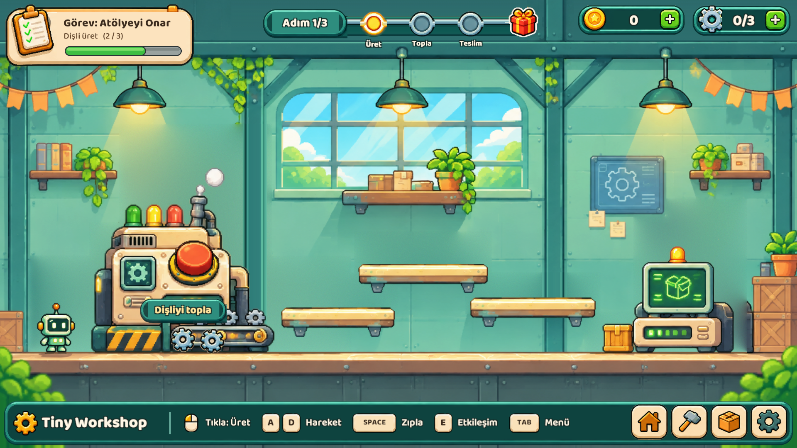
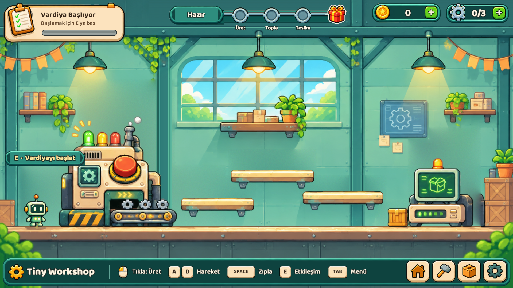
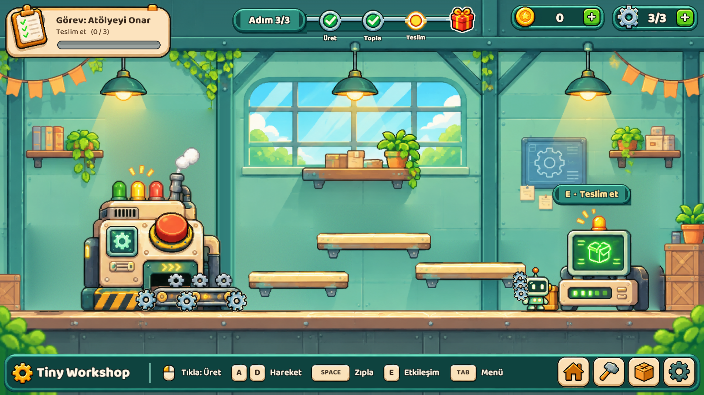
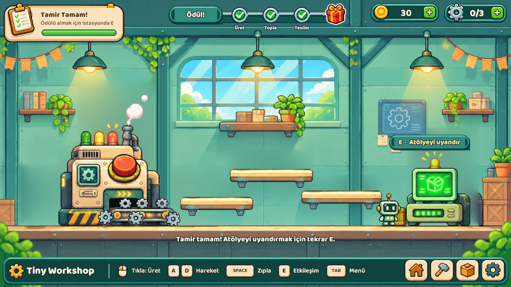
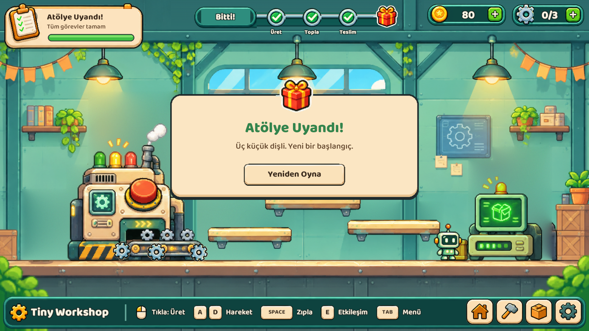

# QuestForge · Tiny Workshop

**EBLG443 Tasarım Kalıpları · Dönem Projesi**
Arif Efe Ekinci · Öğrenci No: 20246000032 · Nişantaşı Üniversitesi

Modüler oyun görev ve ilerleme sistemi (**QuestForge**) ve onu kullanan Unity 6 demosu (**Tiny Workshop**).
Dil: C# · Motor: Unity 6000.3.23f1 (URP 2D, Input System)



---

## 1. Problem

Oyunlarda görev mantığı genellikle tek bir sınıfta, olay türüne ve durum adına göre dallanan `if/else` blokları olarak birikir:

```csharp
// kalıpsız, tek sınıf
void OnEvent(string e, int id) {
  if (state == "Locked") return;
  if (e == "produce") produced++;
  else if (e == "collect") collected++;
  else if (e == "deliver") delivered++;
  if (state == "Active" && produced >= 3 && collected >= 3 && delivered >= 3)
    state = "Completed";
  // her yeni hedef = yeni else-if
}
```

Her yeni hedef türü ve her yeni durum bu metodu büyütür; oyun nesneleri görev sınıfını doğrudan çağırmak zorunda kalır ve görev mantığı motordan bağımsız test edilemez.

QuestForge bu işi dört ayrı sorumluluğa böler:

| Sorumluluk | Kalıp | Grup |
| --- | --- | --- |
| Hedef nesnelerini oluşturmak | **Factory Method** | Yaratımsal |
| Tek hedef ve hedef grubunu aynı şekilde ele almak | **Composite** | Yapısal |
| Oyun olaylarını görev sistemine duyurmak | **Observer** | Davranışsal |
| Görev durumunu ve geçiş kurallarını yönetmek | **State** | Davranışsal |

Dört kalıbın tamamı öğrenci tarafından yazılmıştır; dilin yerleşik `event`/`IObservable` yapısı, lambda ya da çerçeve DI'si kalıp yerine **kullanılmamıştır**. Her rol ayrı bir `interface` / `abstract class` ile tanımlıdır.

## 2. Kalıplar, roller ve koddaki yerleri

Tüm kalıplar `Assets/_TinyWorkshop/Scripts/QuestCore/` altında, kalıp adıyla klasörlenmiştir.
QuestCore saf C#'tır (`noEngineReferences: true`); Unity'ye hiç referans vermez.

### 2.1 Factory Method (Yaratımsal) · `QuestCore/FactoryMethod/`

| Rol | Tip |
| --- | --- |
| Creator | `ObjectiveCreator` (abstract, `Create(int target)`) |
| ConcreteCreator | `ProduceObjectiveCreator`, `CollectObjectiveCreator`, `DeliverObjectiveCreator` |
| Product | `Objective` (abstract) |
| ConcreteProduct | `ProduceObjective`, `CollectObjective`, `DeliverObjective` |
| Client | `WorkshopQuest` kurucusu |

**Neden:** Görev, hangi somut hedef sınıfının oluşturulacağını bilmeden hedef üretir. Yeni hedef türü = yeni `Objective` + yeni `Creator`; mevcut sınıflar değişmez (Açık/Kapalı ilkesi). Hedef ≥ 1 doğrulaması da oluşturucuda tek yerde yapılır.

### 2.2 Composite (Yapısal) · `QuestCore/Composite/`

| Rol | Tip |
| --- | --- |
| Component | `IQuestNode` (`IsComplete`) |
| Leaf | `Objective` ve alt sınıfları |
| Composite | `QuestGroup` (çocukları `IQuestNode[]`) |

**Neden:** "Görev tamam mı?" sorusu tek hedefe de, hedef grubuna da aynı şekilde sorulur. Grup, çocukları `IQuestNode` tuttuğu için başka grupları da içerebilir (iç içe alt görevler). Boş grup tamamlanmış sayılmaz.

### 2.3 Observer (Davranışsal) · `QuestCore/Observer/`

| Rol | Tip |
| --- | --- |
| Subject | `GameEventPublisher` (`Subscribe`, `Unsubscribe`, `Publish`) |
| Observer | `IGameEventObserver` (`OnGameEvent`) |
| ConcreteObserver | `WorkshopQuest`, `Objective` |
| Bildirim verisi | `GameEvent` (`Kind`, `PartId`) |

**Neden:** Oyun nesneleri (`WorkshopMachine`, `Gear`, `RepairStation`) yalnızca `publisher.Publish(new GameEvent(...))` çağırır; görevi tanımazlar. Görev de olayı üreten nesneyi tanımaz. Sahne kapanınca `WorkshopQuest.Dispose()` abonelikten çıkar (sızıntı yok).

| Oyun nesnesi | Oyuncu ne yapar | Yayınlanan olay |
| --- | --- | --- |
| `WorkshopMachine` | Turuncu düğmeye 3 tık | `PartProduced` |
| `Gear` | Robot dişliye dokunur | `PartCollected` |
| `RepairStation` | İstasyonda **E** | `PartDelivered` |

### 2.4 State (Davranışsal) · `QuestCore/State/`

| Rol | Tip |
| --- | --- |
| Context | `WorkshopQuest` (`Start`, `ClaimReward`, `OnGameEvent` → `state`'e devreder) |
| State | `IQuestState` + varsayılan davranışlı `QuestState` |
| ConcreteState | `LockedState`, `ActiveState`, `CompletedState`, `RewardClaimedState` |

```
Locked --Start()--> Active --(3/3 · 3/3 · 3/3)--> Completed --ClaimReward()--> RewardClaimed
```

| Durum | `Start()` | `OnEvent` | `ClaimReward()` |
| --- | --- | --- | --- |
| Locked | → Active | yok sayılır | false |
| Active | false | hedefleri ilerletir; hepsi tamamsa → Completed | false |
| Completed | false | yok sayılır | → RewardClaimed |
| RewardClaimed | false | yok sayılır | false |

**Neden:** Her durum yalnızca kendi geçişini yazar; `if (state == "...")` dallanması yoktur. Kilitliyken gelen olaylar ve ödülün iki kez alınması durum sınıfları tarafından engellenir. `Transition` `internal`'dır, yani durumu yalnızca durum sınıfları değiştirebilir.

### 2.5 Dört kalıp birlikte: bir dişli toplanınca

1. `Gear` → `WorkshopSession.TryCollect(gear)` (Unity tarafı)
2. `publisher.Publish(GameEvent(PartCollected, id))` → **Observer**
3. `WorkshopQuest.OnGameEvent` → `state.OnEvent` → **State**
4. `ActiveState` → `quest.AdvanceObjectives(e)`: **Factory** ile üretilen her `Objective` yalnızca kendi türünü sayar (aynı dişli iki kez sayılmaz)
5. `quest.IsComplete` → `QuestGroup.IsComplete` → **Composite**
6. Tamamsa `Transition(new CompletedState())`; HUD bir sonraki karede gösterir

## 3. Mimari

```
Assets/_TinyWorkshop/Scripts
├── QuestCore/      Saf C# görev sistemi, 4 kalıbın tamamı (Unity referansı yok)
│   ├── FactoryMethod/  Composite/  Observer/  State/
│   └── WorkshopQuest.cs   (kalıpları birleştiren görev / State Context)
├── Gameplay/       WorkshopSession, WorkshopMachine, Gear, RepairStation, RobotController2D
├── Presentation/   WorkshopHud, WorkshopFeedback (arayüz, ses, efekt)
└── Editor/         Sahne/prefab oluşturucu, sprite içe aktarma ayarları
```

Bağımlılık tek yönlüdür: **Gameplay → QuestCore**. QuestCore hiçbir Unity tipini bilmediği için Unity olmadan da derlenip test edilebilir.

## 4. Ekran görüntüleri (Unity, `04_MainGame` sahnesi)

| Durum | Görüntü |
| --- | --- |
| **Locked**: vardiya başlamadı, "E · Vardiyayı başlat" |  |
| **Active**: makinede dişli üretiliyor, *Üret 2/3* (`PartProduced`) |  |
| **Active**: 3 dişli toplandı, robot istasyonda, *Teslim 0/3* (`PartCollected`) |  |
| **Completed**: üç hedef tamam (`QuestGroup.IsComplete`), ödül bekliyor |  |
| **RewardClaimed**: ödül alındı, atölye uyandı |  |

## 5. Çalıştırma

1. Projeyi Unity **6000.3.23f1** ile açın.
2. `Assets/_TinyWorkshop/Scenes/04_MainGame.unity` sahnesini açıp **Play**'e basın.
3. **E** ile vardiyayı başlatın → makinenin turuncu düğmesine 3 kez tıklayın → **Space** ile zıplayıp dişlilere dokunun → sağdaki istasyonda **E** ile teslim edin → tekrar **E** ile ödülü alın.

Kontroller: **A/D** veya oklar hareket · **Space** zıpla · **E** etkileşim · **R** yeniden başlat · **Tab** menü · **F1–F4** sahne değiştir.

## 6. Testler

| Paket | İçerik |
| --- | --- |
| `Tests/EditMode/QuestCoreTests.cs` (7 test) | `FactoriesCreateMatchingObjectiveKinds`, `InvalidTargetIsRejected` (Factory) · `EmptyCompositeIsNotACompletedQuest` (Composite) · `RepeatedEventsAdvanceEachObjectiveOnlyOnce`, `DisposeRemovesObserverAndDisablesQuest` (Observer) · `LockedQuestIgnoresEventsAndRejectsReward`, `AllObjectivesRequiredAndRewardClaimedExactlyOnce` (State) |
| `Tests/PlayMode/GameplayTests.cs` (13 test) | Girdi, fizik ve gerçek üretim → toplama → teslim → ödül akışıyla oyunu baştan sona bitiren entegrasyon testleri |
| `Tools/QuestCore.Checks` | Aynı QuestCore kaynağını Unity olmadan .NET 8 ile derleyip çalıştırır |

Unity'de: **Window › General › Test Runner** → EditMode ve PlayMode. Unity'siz:

```powershell
dotnet run --project Tools/QuestCore.Checks
```

## 7. Notlar

- Görseller ve sesler projeye özgüdür (`Tools/generate_assets.py`, `Tools/redesign_assets.py`); harici ücretli varlık kullanılmamıştır.
- `Packages/` altında gömülü MCP for Unity (MIT lisanslı) yalnızca geliştirme aracıdır; kalıp sayısına dâhil değildir.
- Kapsam: tek oda, tek dişli türü, üç parçalı tek görev.
