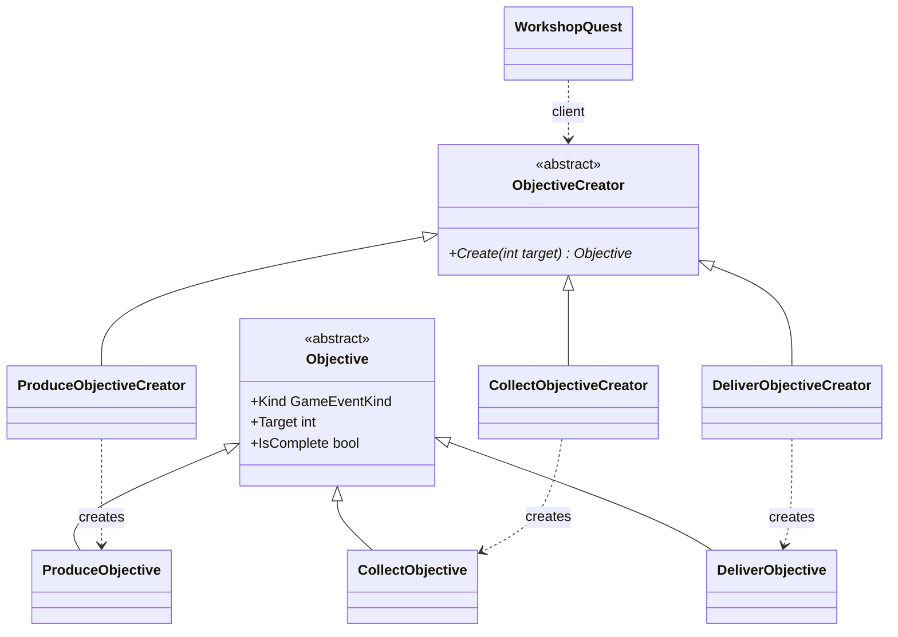
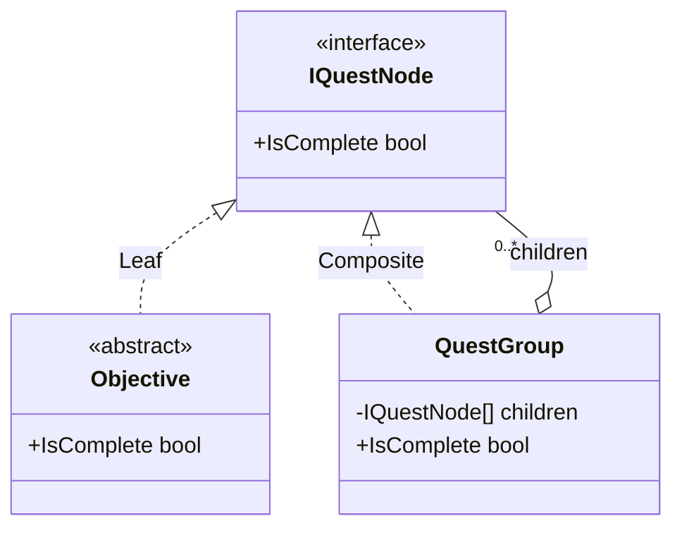
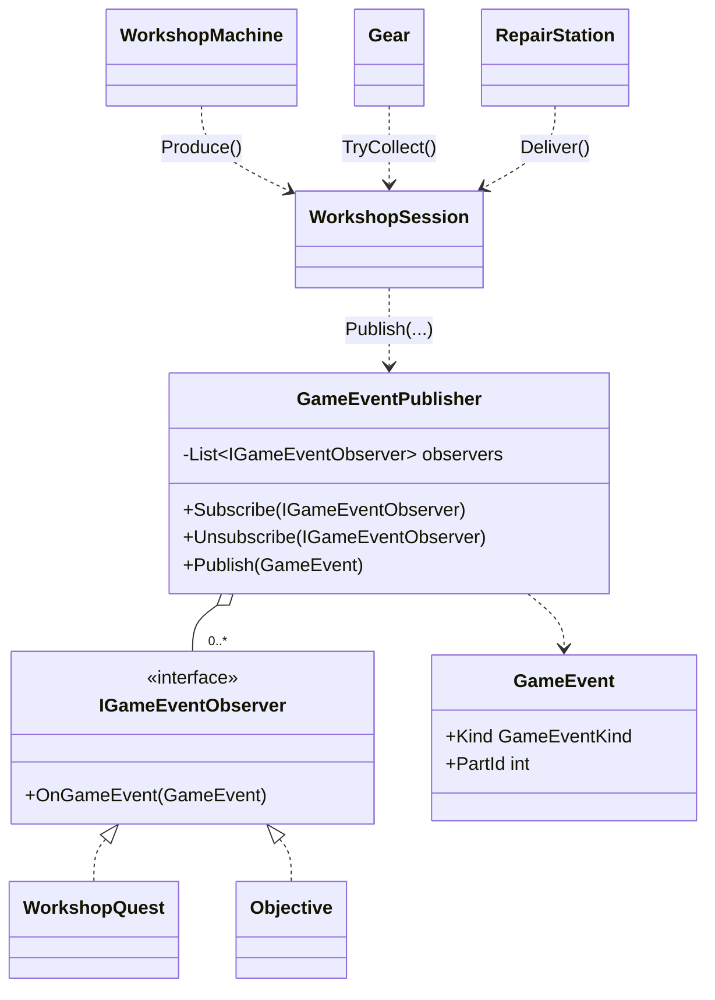
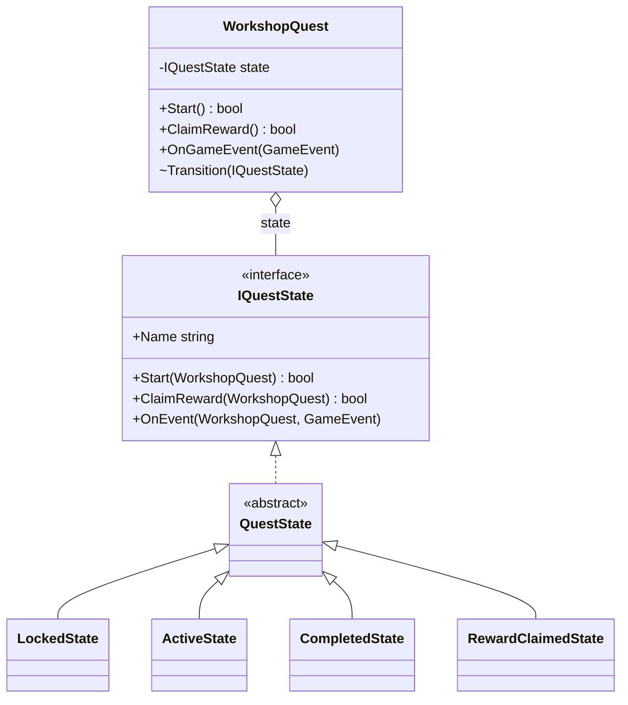
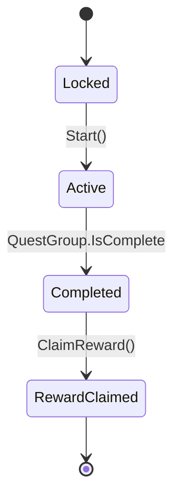
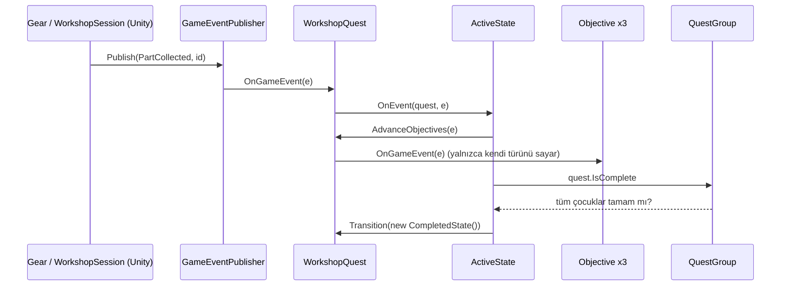

# Tasarım Kalıpları · Sınıf Diyagramları

QuestForge · EBLG443 Tasarım Kalıpları

Dört GoF kalıbı `Assets/_TinyWorkshop/Scripts/QuestCore/` altında, kalıp adıyla klasörlenmiştir. Her dosyanın başında `// [KALIP: <ad>] Rolü: <rol>` yorumu vardır; kodda aramak için:

```powershell
git grep -n "\[KALIP:"
```

| Grup | Kalıp | Klasör | Çözdüğü problem |
| --- | --- | --- | --- |
| Yaratımsal | Factory Method | `QuestCore/FactoryMethod/` | Görev, somut hedef sınıflarını bilmeden hedef üretir |
| Yapısal | Composite | `QuestCore/Composite/` | Tek hedef ve hedef grubu aynı arayüzle "tamam mı?" sorusuna cevap verir |
| Davranışsal | Observer | `QuestCore/Observer/` | Oyun nesneleri ve görev sistemi birbirini tanımadan haberleşir |
| Davranışsal | State | `QuestCore/State/` | Görev durumuna göre değişen davranış `if/else` yerine durum sınıflarındadır |

Öneri belgesindeki "eşya toplama / bölgeye ulaşma / düşman yenme" hedefleri, demodaki atölye temasına **üret / topla / teslim et** olarak uyarlanmıştır; kalıplar ve rolleri birebir aynıdır.

---

## 1. Factory Method



| Rol | Tip | Dosya |
| --- | --- | --- |
| Creator | `ObjectiveCreator` | `FactoryMethod/ObjectiveCreator.cs` |
| ConcreteCreator | `ProduceObjectiveCreator`, `CollectObjectiveCreator`, `DeliverObjectiveCreator` | `FactoryMethod/*Creator.cs` |
| Product | `Objective` | `FactoryMethod/Objective.cs` |
| ConcreteProduct | `ProduceObjective`, `CollectObjective`, `DeliverObjective` | `FactoryMethod/*Objective.cs` |
| Client | `WorkshopQuest` (kurucu) | `QuestCore/WorkshopQuest.cs` |

**Kalıp kaldırılırsa:** `WorkshopQuest` her hedef türü için `new` ile somut sınıfa bağlanır; yeni hedef eklemek görev sınıfını değiştirmeyi gerektirir.

## 2. Composite



| Rol | Tip | Dosya |
| --- | --- | --- |
| Component | `IQuestNode` | `Composite/IQuestNode.cs` |
| Leaf | `Objective` (+ alt sınıfları) | `FactoryMethod/Objective.cs` |
| Composite | `QuestGroup` | `Composite/QuestGroup.cs` |

**Kalıp kaldırılırsa:** tamamlanma kontrolü `produce.IsComplete && collect.IsComplete && ...` olarak sabit yazılır; iç içe alt görevler desteklenemez.

## 3. Observer



Unity tarafında olayları `WorkshopSession` yayınlar (`Produce` → `PartProduced`, `TryCollect` → `PartCollected`, `Deliver` → `PartDelivered`); makine, dişli ve istasyon yalnızca oturumu çağırır, görev sınıfını hiç tanımaz.

| Rol | Tip | Dosya |
| --- | --- | --- |
| Subject | `GameEventPublisher` | `Observer/GameEventPublisher.cs` |
| Observer | `IGameEventObserver` | `Observer/IGameEventObserver.cs` |
| ConcreteObserver | `WorkshopQuest`, `Objective` | `QuestCore/WorkshopQuest.cs`, `FactoryMethod/Objective.cs` |
| Bildirim | `GameEvent` | `Observer/GameEvent.cs` |

Abone listesi ve bildirim döngüsü elle yazılmıştır; C#'ın `event`/`IObservable<T>` yapısı kalıp için **kullanılmamıştır** (yalnızca HUD'u yenilemek için `WorkshopQuest.Changed` vardır, kalıp sayımına dâhil değildir).

**Kalıp kaldırılırsa:** oyun tarafı `WorkshopQuest`'i doğrudan çağırmak zorunda kalır; görev sistemi Unity nesnelerine bağımlı olur.

## 4. State





| Rol | Tip | Dosya |
| --- | --- | --- |
| Context | `WorkshopQuest` | `QuestCore/WorkshopQuest.cs` |
| State | `IQuestState` (+ varsayılan davranışlı `QuestState`) | `State/IQuestState.cs` |
| ConcreteState | `LockedState`, `ActiveState`, `CompletedState`, `RewardClaimedState` | `State/*State.cs` |

**Kalıp kaldırılırsa:** `Start`, `ClaimReward` ve `OnGameEvent` metotlarının her biri `if (state == "...")` dallanmasına döner.

## 5. Kalıpların birlikte çalışması (bir dişli toplanınca)


